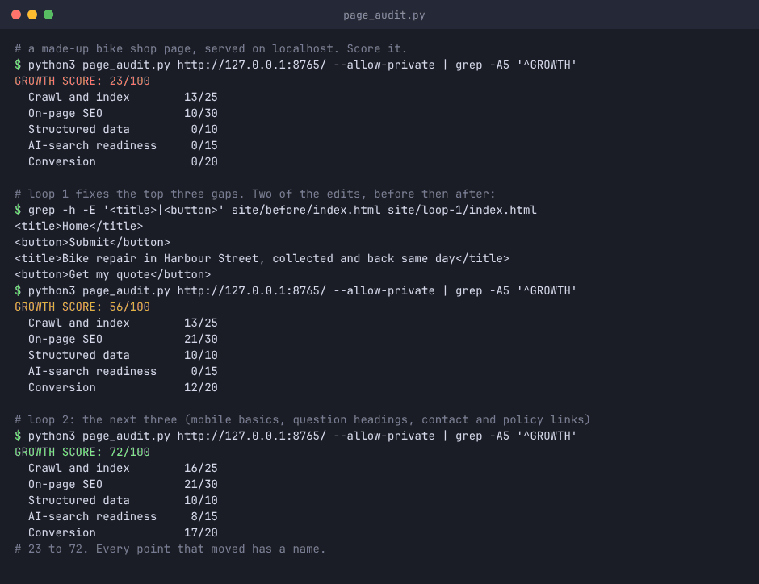
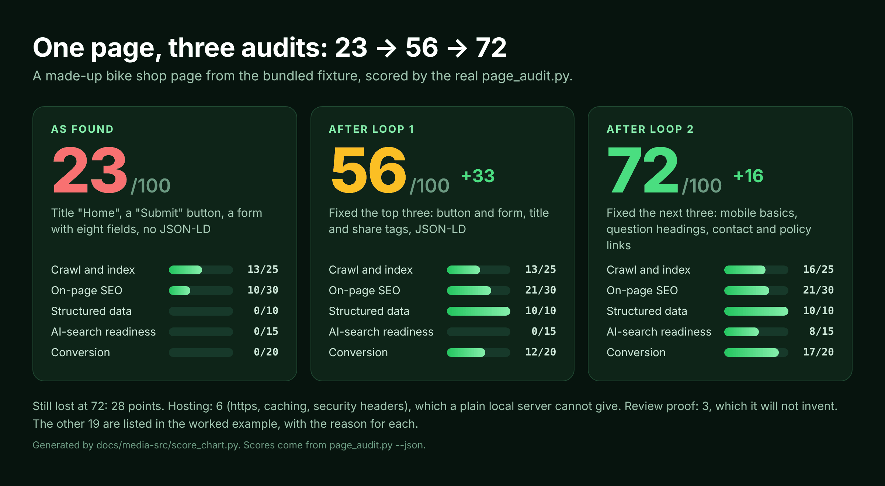
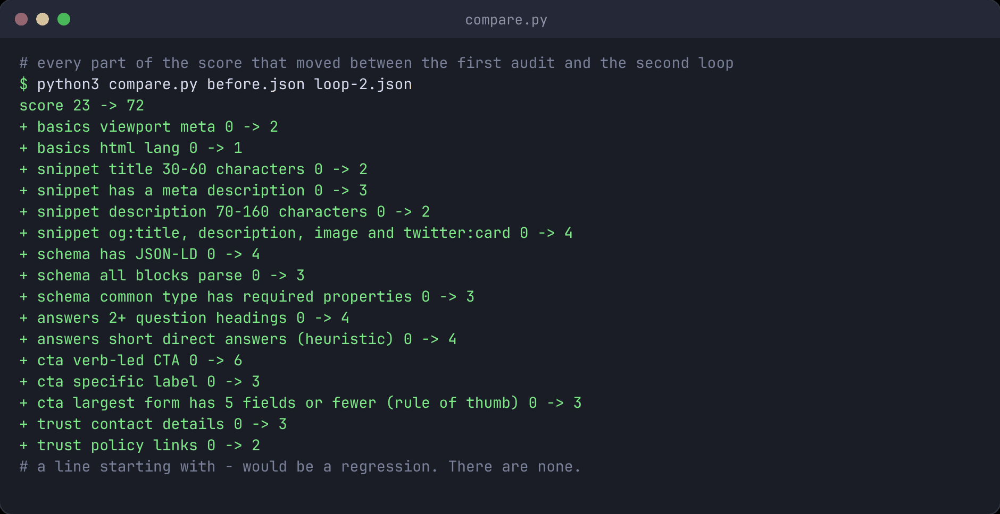
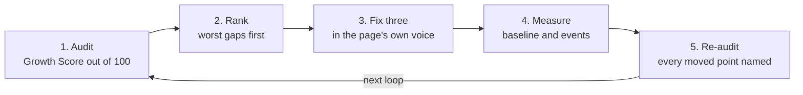
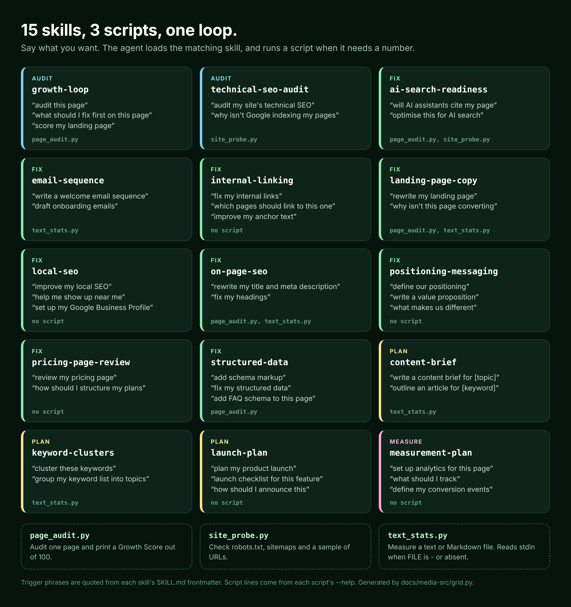

<p align="center"></p>
<h1 align="center">Growth Stack</h1>
<p align="center"><b>Audit a page, fix the three biggest gaps, measure, audit again. Every point of the score has a name.</b></p>
<p align="center"><a href="https://github.com/FinnTech3/growth-stack/actions/workflows/ci.yml"></a>   </p>
<p align="center"></p>
<p align="center"><sub>Real output, 18 seconds, on the fixture page in this repo. The "fixed" copies are the bundled loop-1 and loop-2 folders, served at the same URL.</sub></p>

## The straight answer

- **What it does.** `page_audit.py` fetches one page and scores it out of 100 across 11 checks and 37 named parts. Fifteen
  skills turn each gap into a fix written in the page's own voice. Then you audit the same URL again, and the report lists
  every point that moved and flags any that dropped.
- **What it needs.** Python 3.10 or newer on the machine that runs your agent, and network access to the pages you ask it to
  audit. The three scripts are standard library only. Nothing is installed and there are no accounts or keys.
- **What it will not do.** Promise rankings, traffic or revenue. The score is a diagnostic, and the report says so. It will
  not invent a testimonial, a statistic or a price: missing proof is a marked gap.

## See it work

<p align="center"></p>

Three audits of one made-up bike shop page, drawn from `page_audit.py --json`. Notice which categories move: loop 1 only
touches on-page, structured data and conversion, and AI-search readiness waits for loop 2.

<p align="center"></p>

The comparison from the loop reference: 49 points across 16 named parts, and no line starting with `-`, which would be a
regression. [The worked example](agensi/growth-stack/examples/growth-loop-worked-example.md) has every command and every
output, including the site probe.

## Run it in 60 seconds

From a clone, on the fixture page (it has deliberate flaws, and the script exits 1 because it finds high-severity gaps):

```bash
git clone https://github.com/FinnTech3/growth-stack && cd growth-stack
python3 -m http.server 8765 --bind 127.0.0.1 \
  --directory agensi/growth-stack/examples/fixture-site/before &
python3 agensi/growth-stack/shared/scripts/page_audit.py http://127.0.0.1:8765/ --allow-private
kill $!        # stop the server; then serve loop-1 or loop-2 the same way to see 56 and 72
```

On a real page: `python3 agensi/growth-stack/shared/scripts/page_audit.py https://your-site.example/page`. `--allow-private`
is only for your own local or staging site; without it, private and loopback addresses are refused.

## Use it with your agent

Ask in your own words: "Audit https://your-site.example/page and tell me what to fix first."

1. The agent picks `growth-loop` from its description, and writes `page_audit.py` unchanged to a temporary file.
2. It runs the script, deletes the file, and reads you the report: the score, then the gaps worst first.
3. It takes the top three gaps and hands each to the fixer skill named in the routing table, which writes the fix
   in the page's own voice (measured with `text_stats.py`).
4. After you ship, it audits the same URL again and shows what moved.

On Agensi the agent receives the skills and `shared/scripts/` as text. From a clone, copy the skill folders you want into your
agent's skills folder and put `shared/scripts/` beside them, because the skills refer to scripts by that path. The trigger
prompts in [agensi/TRIGGER_TESTS.md](agensi/TRIGGER_TESTS.md) have not been run in an agent yet.

## How it works



`page_audit.py` fetches one page (http or https only, five redirects at most, 2 MB and 10 seconds at most) and runs 11
checks made of 37 named parts worth 100 points. I fix at most three gaps per loop, so you can tell which change moved which
points.

The 100 points:

| Category | Points | Checks |
|---|---:|---|
| Crawl and index | 25 | `basics`, `indexable`, `delivery` |
| On-page SEO | 30 | `snippet`, `content`, `links-images` |
| Structured data | 10 | `schema` |
| AI-search readiness | 15 | `answers`, `authority` |
| Conversion | 20 | `cta`, `trust` |

The three scripts:

| Script | What it does |
|---|---|
| `page_audit.py` | One page: the Growth Score, every point named, the gaps ranked. |
| `site_probe.py` | robots.txt rules for search and AI crawlers, sitemaps, and a sample of URLs: status, redirects, noindex, canonicals, mixed content. |
| `text_stats.py` | Offline. Readability (formulas stated), keywords, outline, repeated openings, passive voice and hedges (labelled heuristics), you versus we. |

The fifteen skills, with when to use each, are in [the pack README](agensi/growth-stack/README.md). Each is a `SKILL.md` of
120 lines or fewer, with references, and names its neighbours in its "Do not use" line so the right one loads.

<p align="center"></p>

## What it costs you

| Cost | What you pay |
|---|---|
| Install | None. The agent writes a script to a temporary file and deletes it after. |
| Network | `page_audit.py` reads one page. `site_probe.py` reads that site's robots.txt, its sitemaps and a small sample of pages. User agent `FinnTech-Growth-Audit/1.0`. `text_stats.py` makes no network calls. |
| Permissions | Write a temp file, run `python3`, read the URL you gave. No credentials. It changes nothing on your site: you get copy, markup and config to paste. |

## Safety

- Private, loopback, link-local, multicast and reserved addresses are refused unless you pass `--allow-private`. The check
  runs on every redirect hop, before connecting and again on the address actually connected, so a DNS trick cannot reach an
  internal host.
- Size, time and redirect limits. A gzip bomb is capped and a slow drip hits a total deadline. robots.txt patterns are
  matched without regular expressions, so a hostile file cannot stall the probe. Sitemaps on another host are reported, never fetched.
- No `shell=True`, no `eval`, no environment variables. The network scripts read no local files, and `text_stats.py` makes no
  network calls. Exit codes: 0 ok, 1 a high or critical finding (or the site could not be reached), 2 bad input.

## Why it's built this way

- **One file per script.** Agensi delivers text and the agent writes each script to a temporary file, so a script cannot
  import another. Each is a single standard-library file under 20 KB, and a test checks the network scripts share one
  identical fetch layer.
- **Two-space indents in the scripts.** It is the only way I fitted the full rubric and the safe fetching into 20 KB.
- **The score names every point.** No black box, so you can argue with it. A fix is only a fix if it recovers named points.
- **Measuring and writing are separate.** The scripts measure. The skills write. The scripts never guess at copy and the
  skills never guess at numbers.

## What it won't do

- Promise rankings, traffic, citations or revenue, or replace a crawler, analytics or a keyword tool. Bring an export and
  it works from that. It does not do backlinks, rankings or Core Web Vitals.
- Run JavaScript. It reads the HTML a crawler gets first, so JavaScript-only content is not seen.
- Recover everything. At 72 the fixture still loses 28 points: 6 are hosting (https, caching, security headers), 3 are review
  proof it will not invent, and the worked example lists the other 19 with the reason for each.
- Pick your AI crawler policy. The list in `site_probe.py` is short on purpose; add more with `--agent`.
- Be exact on heuristics. Answer length, proof, thin content and CTA wording are rules of thumb, and the reports label them.

## Develop / verify

```bash
pip install -e ".[dev]"
ruff check .
pytest                                              # 269 offline tests
python3 tools/agensi_build.py agensi/growth-stack   # checks the pack, writes dist/growth-stack.zip
```

The scripts live once, in `agensi/growth-stack/shared/scripts/`; edit them there. Tests use local `http.server` fixtures for
every flaw and every pass: redirects, timeouts, oversized bodies, non-HTML, broken HTML, private-address blocking, robots
rules, sitemap indexes and the score arithmetic. To regenerate the images and the clip, run `docs/media-src/build-media.sh`
(needs PyYAML, Pillow, Node with Playwright and ffmpeg). It runs the real scripts on the fixture, so the numbers cannot drift.

## Finn's take

Most SEO output is a long list with no order and no proof, and most marketing advice never looks at the page. I wanted one
loop that does both: measure the page, fix the three biggest things, measure again. The score is a diagnostic and it is wrong
sometimes, which is why the heuristic checks say so. If a skill tells you to change something, it should be able to say which
points that change recovers.

Built by FinnTech3.

## Licence

MIT, Copyright (c) 2026 FinnTech3. See [LICENSE](LICENSE).
